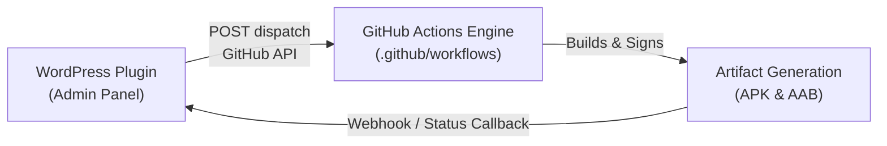

# Bizgrowth360 Android Automated Build Engine

A complete, production-ready Android automated build pipeline using **GitHub Actions**, **Capacitor**, and modern **Android build tools**.

This build engine dynamically generates real, verifiable Android **APK** (Android Package) and **AAB** (Android App Bundle) binaries from web configurations. It is designed as the core compilation engine for the future Bizgrowth360 App Builder WordPress plugin.

---

## 🌟 Key Features

- **Real Android Package Compilation**: Builds authentic Android `.apk` and `.aab` packages via Gradle 8.11 and Android SDK Platform 35.
- **Dynamic App Configuration**: Fully customizable app name, package ID, website URL, version name, version code, colors, orientation, and external link handling.
- **Automated Branding Engine**: Generates all required Android launcher mipmaps (standard, circular, and Android adaptive icons) and splash screens on-the-fly from high-res SVG vectors or custom images.
- **Resilient Mobile App Shell**:
  - Displays instant branded loading spinner upon launch (zero blank screens).
  - Handles internet disconnects gracefully with a custom offline error screen and one-tap retry button.
  - Proper Android hardware back button navigation (history navigation inside WebView + double-tap to exit).
  - Native intent handling for `tel:`, `mailto:`, `sms:`, and `whatsapp:`.
- **Cryptographic Release Signing**:
  - Secure in-memory/temporary keystore decoding using GitHub Repository Secrets.
  - Generates signed Release APKs and Play Store-ready AAB bundles.
  - Automatic fallback to labelled debug signing if secrets are not configured.
- **Strict Package Validation**:
  - Verifies file size, ZIP structure, Dex classes, resources, and package IDs before uploading.
- **GitHub Actions Step Summary**: Publishes a formatted Markdown summary showing build statuses, metadata, hashes, and download links.

---

## 🏗️ Repository Architecture

```text
bizgrowth360-android-builder/
├── .github/
│   └── workflows/
│       └── android-build.yml       # Production GitHub Actions workflow
├── app-template/
│   ├── package.json                # Capacitor dependencies & CLI
│   ├── capacitor.config.ts         # TypeScript Capacitor configuration
│   ├── capacitor.config.json       # JSON Capacitor configuration
│   ├── src/                        # Web app shell source files
│   │   ├── index.html              # Shell HTML with loader & offline state
│   │   ├── app.css                 # Responsive mobile styling
│   │   ├── app.js                  # Online/offline detection & retry logic
│   │   └── app-config.js           # Dynamic runtime configuration
│   ├── public/                     # Static assets bundled into APK
│   └── android/                    # Complete Android Gradle project
│       ├── app/                    # Main application module
│       │   ├── build.gradle        # App Gradle script & signing configs
│       │   └── src/main/           # AndroidManifest, Java, and resources
│       ├── build.gradle            # Root Gradle script
│       └── gradlew, gradlew.bat    # Gradle 8.11.1 wrapper
├── scripts/
│   ├── validate-config.js          # Validates config & package ID rules
│   ├── prepare-app.js              # Injects dynamic config into Android
│   ├── generate-icons.js           # Generates all mipmaps & splash screens
│   └── validate-output.js          # Validates APK/AAB structure & signatures
├── config/
│   └── default-app.json            # Base app configuration
├── docs/
│   ├── SETUP.md                    # Environment and secrets setup
│   ├── BUILD.md                    # Triggering builds & installing APKs
│   ├── SIGNING.md                  # Keystore generation & Base64 encoding
│   └── TROUBLESHOOTING.md          # Common errors and resolutions
├── README.md
└── .gitignore
```

---

## ⚙️ Configuration Schema

The build engine accepts configuration via JSON files or command-line arguments:

```json
{
  "app_name": "Demo Website App",
  "package_id": "in.bizgrowth360.demoapp",
  "website_url": "https://example.com",
  "version_name": "1.0.0",
  "version_code": 1,
  "app_icon": "public/icon.png",
  "splash_image": "public/splash.png",
  "primary_color": "#2563EB",
  "background_color": "#FFFFFF",
  "status_bar_color": "#2563EB",
  "navigation_bar_color": "#FFFFFF",
  "orientation": "portrait",
  "allow_external_links": true
}
```

### Validation Rules
- **`package_id`**: Must contain at least two segments (e.g. `com.company.app`). Each segment must start with a letter and contain only alphanumeric characters or underscores. Java reserved keywords (`switch`, `class`, `default`, etc.) are rejected.
- **`website_url`**: Must be a valid `https://` URL.
- **`version_code`**: Must be a positive integer `>= 1`.
- **`colors`**: Must be valid Hex color codes (`#RRGGBB` or `#RGB`).

---

## 🚀 How to Trigger a Build in GitHub Actions

1. Navigate to the **Actions** tab in your GitHub repository.
2. Under **Workflows**, click **Bizgrowth360 Android Build Engine**.
3. Click the **Run workflow** button on the right.
4. Fill in or accept the custom inputs:
   - **App Display Name**: `My Store App`
   - **Android Package ID**: `com.mystore.android`
   - **Website URL**: `https://mystore.example.com`
   - **Version Name**: `1.0.0`
   - **Version Code**: `1`
   - **Build Type**: `both` (Debug & Release)
   - **Build Target**: `both` (APK & AAB)
5. Click **Run workflow**.

When complete, download your artifacts from the **Artifacts** section at the top of the workflow run:
- `Bizgrowth360-<AppName>-<Version>-APK`: Installable APK files.
- `Bizgrowth360-<AppName>-<Version>-AAB`: Google Play upload bundle.

---

## 🔐 Release Signing Secrets

To generate cryptographically signed release builds, configure these 4 repository secrets under **Settings** > **Secrets and variables** > **Actions**:

- `ANDROID_KEYSTORE_BASE64`: Base64 string of your `.jks` file.
- `ANDROID_KEYSTORE_PASSWORD`: Keystore password.
- `ANDROID_KEY_ALIAS`: Alias identifier.
- `ANDROID_KEY_PASSWORD`: Key alias password.

See [docs/SIGNING.md](docs/SIGNING.md) for full instructions on creating and encoding your keystore.

---

## 🔌 Future WordPress Integration Architecture

This engine is architected to be driven headlessly by the future Bizgrowth360 App Builder WordPress plugin:



- **Payload Input**: The future WordPress plugin sends the build JSON payload via the GitHub REST API (`POST /repos/{owner}/{repo}/actions/workflows/android-build.yml/dispatches`).
- **Response**: The plugin polls or receives webhook callbacks with build status, completion timestamps, and direct download URLs.

---

## 🧪 Local Testing & Verification

Run validation scripts locally:
```bash
# Validate config & test suite
npm run validate
npm test

# Prepare app template
npm run prepare-app

# Generate all mipmap icons and splash screens
npm run generate-icons

# Validate output packages
npm run validate-output
```
